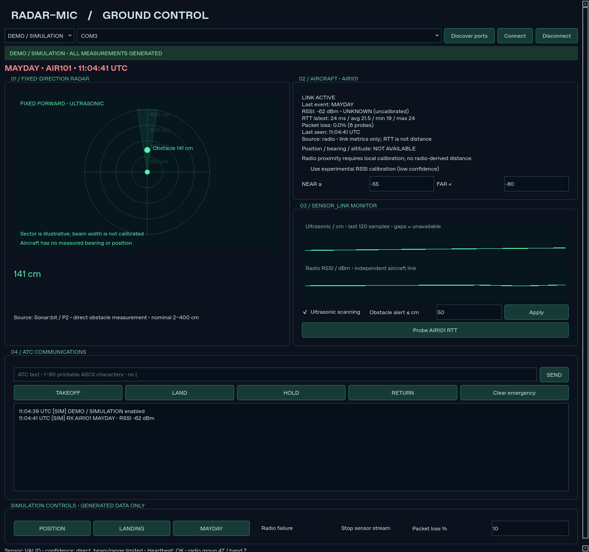

# RADAR-MIC

Windows desktop ground console and two BBC micro:bit V2 MakeCode programs:
**PC ↔ USB serial ↔ GROUND01 ↔ built-in radio ↔ AIR101**.



Stationary forward ultrasonic obstacle sensing and aircraft communication are
independent. There is no angular scan, aircraft location, physical radio range,
or altitude measurement. RTT is communication latency. RSSI proximity is
experimental and defaults to UNKNOWN until you enable local calibration.

## Windows 11 quick start

For prebuilt files, download the Windows and firmware artifacts from the same
[successful build](https://github.com/Wondris404/Radar-Mic/actions/workflows/verify.yml).
Choose a build containing USB protocol 2. Follow the
[wiring, flashing, and first hardware test](docs/HARDWARE.md).

Install **Python 3.11 or newer** from python.org (including the `py` launcher), and
Git for Windows. Open PowerShell:

```powershell
git clone https://github.com/Wondris404/Radar-Mic.git
cd Radar-Mic
powershell -ExecutionPolicy Bypass -File scripts\install.ps1
.\Launch.cmd --demo
```

Demo mode works without hardware. Its green banner and log entries explicitly
label generated measurements. Use the simulation controls for POSITION, LANDING,
MAYDAY, packet loss, radio failure, and stopped sensor telemetry. Scroll down to
see the controls on shorter screens. Switching modes clears all sensor state
and pending commands. Hardware never substitutes simulated data.

For real operation:

```powershell
.\Launch.cmd
```

Flash the two boards as described below, connect **GROUND01** by USB, choose
**HARDWARE**, Discover ports, select its COM port and Connect. Manual COM entry is
supported. Wait for protocol 2 compatibility, Heartbeat: OK, and LINK ACTIVE.
Type `AIR101 HOLD` and press SEND. **ACK RECEIVED** confirms aircraft firmware
accepted the text for LED display. A timeout leaves reception unconfirmed.
Use **Cancel pending text** to stop further attempts once ground confirms
cancellation. Buttons on aircraft: **A** position/proximity report, **B** landing
request, **A+B** MAYDAY. Aircraft scrolls confirmation of its event delivery.
Ground **A** toggles sampling; **B** displays link/sensor status.

The console includes a fixed forward sonar marker, obstacle alerts, independent
radio information, latest/average/min/max RTT, rolling packet loss, RSSI and sonar
history, timestamped communications, presets, diagnostics and reconnect attempts.
MAYDAY stays latched across USB disconnect and reconnect within the running app.
**Acknowledge MAYDAY** clears it. The most recent 120 samples/probes and 500 log
lines are held in memory.

## Firmware and wiring

Ground Sonar:bit: **Signal → P2, Voltage → 3V, Ground → GND**. No servo. Aircraft
uses its built-in radio and USB power bank. Both boards must be micro:bit **V2**.

Use MakeCode JavaScript projects with `main.ts`, `radio.ts`, and `pxt.json` from
`firmware/ground` and `firmware/aircraft`, respectively. The ground dependency is
pinned to ELECFREAKS Sonar:bit source. See [full flash and bench instructions](docs/HARDWARE.md).

For ready-to-flash HEX files, open this repository's **Actions → Test and build
Windows desktop**, choose a successful run and download **RADAR-MIC-Firmware**.
Copy `radar-mic-ground.hex` to ground's MICROBIT drive and
`radar-mic-aircraft.hex` to aircraft's drive. Firmware source is included in the
MakeCode HEX files. Downloading Actions artifacts requires a GitHub login.

To compile locally, install Node.js 24+ (npm 11+) and Git:

```powershell
npm ci --prefix tools --ignore-scripts
node tests/radio.test.cjs
node scripts/build-firmware.cjs
```

Output: `dist/firmware/*.hex`. The build script uses pinned MakeCode target 9.1.2,
installs built-in dependencies, and fetches the exact pinned Sonar:bit revision
via Git. No external radio module or native C++ toolchain is required for the
standard cached MakeCode runtime. Internet access is required on the first build. The tooling lockfile unifies the
unused Puppeteer browser dependency across MakeCode packages; install scripts are
disabled because firmware compilation needs no browser download.
`firmware/shared.ts` is the source of the identical two `radio.ts` copies; update
all three together (tests enforce equality).

## Build the Windows app

After installation:

```powershell
.\scripts\build-windows.ps1
```

Output: `dist\RADAR-MIC\RADAR-MIC.exe` and `dist\RADAR-MIC-Windows.zip`.
Keep the entire app directory together; extract the ZIP before launching.
Executables are unsigned. GitHub Actions runs Python tests and packages a Windows
artifact on every push/PR; a separate job tests and compiles both firmwares.

## Architecture and repository

```text
radar_mic/
  app.py          PySide6 console, custom radar/charts, explicit mode switching
  protocol.py     versioned serial validation and bounded stream decoder
  transport.py    nonblocking pyserial, port discovery, command ACK/retry tracking
  state.py        independent sonar/radio state, staleness, calibration, provider API
  simulation.py   deterministic demo events and fault injection
firmware/
  shared.ts       bounded reliable radio transport (also copied into each project)
  ground/         USB bridge, Sonar:bit, command deduplication, RTT probe origin
  aircraft/       button events, heartbeats, text reception, probe replies
scripts/          Windows installation/packaging and firmware builds
tests/            Python protocol/state/UI tests and actual TypeScript host tests
docs/             protocol, wiring, physical limits, demo screenshot
.github/workflows/verify.yml
```

UI timers service a bounded nonblocking serial read and short command writes;
no serial read waits for a newline. Disconnection clears pending commands and
marks telemetry stale. Reconnection tries the selected port every 3 seconds.
Commands require a compatible HELLO and a fresh ground heartbeat. Ground text
transmission has its own deadline so queued commands expire before the desktop
times out, including if USB disconnects. Radio reception is independent of
LED scrolling fibers. Every queue, message, fragment buffer and history is bounded.
The `RangingProvider` protocol is an extension point for **actual** UWB/GPS
adapters; future providers must retain their source, confidence, validity and
coordinate/range semantics. They must not reinterpret current radio metrics as
physical position. No UWB/GPS hardware is assumed by this release.

See [packet formats, examples, limits and delivery semantics](docs/PROTOCOL.md).
This is a classroom/LEGO demonstration, not an operational aviation control system.

## Tests and verification

```powershell
npm ci --prefix tools --ignore-scripts
.\.venv\Scripts\python.exe -m pytest -q
.\.venv\Scripts\python.exe -m radar_mic.app --smoke-test
node tests/radio.test.cjs
```

Linux development uses `python3 -m venv .venv`, `.venv/bin/pip install -e '.[dev]'`,
and `QT_QPA_PLATFORM=offscreen .venv/bin/python -m radar_mic.app --smoke-test`.
The smoke command renders a simulated emergency and exits automatically; ordinary
startup has no timer to exit. Host tests execute the firmware TypeScript with deterministic device I/O.
The cross-runtime tests capture raw ground firmware serial bytes and decode them
with the desktop parser. Install Node.js 24+ and the tooling above to run those
tests with pytest. GitHub Actions also runs them in the firmware build job.

**Physical micro:bits have not been tested.** Follow the bench checklist before
use. Sonar zero cannot distinguish a failed sensor from no echo. Only a missing
sensor stream is detectable as UNAVAILABLE, while radio monitoring remains
independent.
